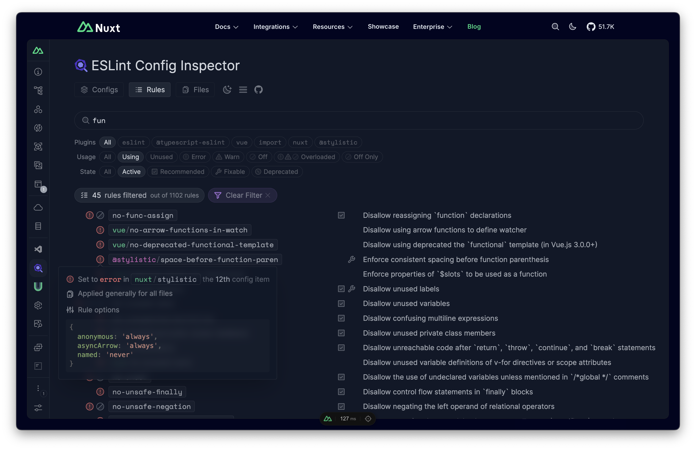

## VS Code

ESLint v9.x support was added in the [ESLint VS Code extension (`vscode-eslint`)](https://marketplace.visualstudio.com/items?itemName=dbaeumer.vscode-eslint) v3.0.10.
In versions of `vscode-eslint` prior to v3.0.10, the new configuration system is not enabled by default. To enable support for the new configuration files, edit your `.vscode/settings.json` file and add the following:

```json [.vscode/settings.json]
{
  // Required in vscode-eslint < v3.0.10 only
  "eslint.useFlatConfig": true
}
```

## NPM Scripts

Add the below to lint commands to your `package.json` script section:

```json
{
  "scripts": {
    ...
    "lint": "eslint .",
    "lint:fix": "eslint . --fix",
    ...
  },
}
```

Run the `npm run lint` command to check if the code style is correct or run `npm run lint:fix` to automatically fix issues.

::warning
Your `eslint.config.mjs` imports the config generated in `.nuxt/`, which only exists after Nuxt has run once. In CI or on a fresh clone, run `nuxt prepare` before ESLint, for example `"lint": "nuxt prepare && eslint ."`.
::

## Prettier

This module does not enable stylistic/formatting rules by default. You can use Prettier alongside directly.

## ESLint Stylistic

If you prefer to use ESLint for formatting, we also directly integrate with [ESLint Stylistic](https://eslint.style/) to make it easy. You can opt in by setting `config.stylistic` to `true` in the `eslint` module options.

```ts [nuxt.config.ts]
export default defineNuxtConfig({
  modules: [
    '@nuxt/eslint'
  ],
  eslint: {
    config: {
      stylistic: true // <---
    }
  }
})
```

You can also pass an object to customize the rules:

```ts [nuxt.config.ts]
export default defineNuxtConfig({
  modules: [
    '@nuxt/eslint'
  ],
  eslint: {
    config: {
      stylistic: {
        indent: 'tab',
        semi: true,
        // ...
      }
    }
  }
})
```

Learn more about all the available options in the [ESLint Stylistic documentation](https://eslint.style/guide/config-presets#configuration-factory).

When stylistic rules are enabled, the keys of your `nuxt.config` are also sorted in a recommended order by the [`nuxt/nuxt-config-keys-order`](/modules/eslint/plugin#nuxtnuxt-config-keys-order) rule. Set `config.nuxt.sortConfigKeys` to `false` to disable it, or to `true` to enable it without stylistic rules.

## Formatters

ESLint only lints JavaScript, TypeScript and Vue files. To also format CSS, HTML, GraphQL and other files with ESLint, enable `config.formatters`. It uses [`eslint-plugin-format`](https://github.com/antfu/eslint-plugin-format) with Prettier under the hood, which you need to install:

```bash
npm i -D eslint-plugin-format
```

```ts [nuxt.config.ts]
export default defineNuxtConfig({
  modules: [
    '@nuxt/eslint'
  ],
  eslint: {
    config: {
      formatters: true // <---
    }
  }
})
```

`true` formats CSS, Less, SCSS, HTML and GraphQL files, plus XML and SVG when `@prettier/plugin-xml` is installed. Markdown is not formatted by default, as many Nuxt projects use MDC syntax with Nuxt Content. Pass an object to pick the file types:

```ts [nuxt.config.ts]
export default defineNuxtConfig({
  modules: [
    '@nuxt/eslint'
  ],
  eslint: {
    config: {
      formatters: {
        css: true,
        html: true,
        markdown: 'prettier', // or 'dprint'
      }
    }
  }
})
```

## Type-Aware Rules

TypeScript support is enabled automatically when `typescript` is installed in your project. To enable [type-aware rules](https://typescript-eslint.io/getting-started/typed-linting/), set `config.typescript.tsconfigPath` to your `tsconfig.json`:

```ts [nuxt.config.ts]
export default defineNuxtConfig({
  modules: [
    '@nuxt/eslint'
  ],
  eslint: {
    config: {
      typescript: {
        tsconfigPath: './tsconfig.json'
      }
    }
  }
})
```

Type-aware rules are slower, as ESLint needs to run the TypeScript compiler. The TypeScript rules use the strict preset by default; set `config.typescript.strict` to `false` to use the recommended one.

## Config Customizations

`withNuxt()` returns a chainable [`FlatConfigComposer` instance](https://github.com/antfu/eslint-flat-config-utils#composer) from [`eslint-flat-config-utils`](https://github.com/antfu/eslint-flat-config-utils) which allows you to manipulate the ESLint flat config with ease.

```js [eslint.config.mjs]
// @ts-check
import withNuxt from './.nuxt/eslint.config.mjs'

export default withNuxt(
  // ...Custom flat configs append after nuxt's configs
)
  .prepend(
    // ...Prepend some flat configs in front
  )
  // Override some rules in a specific config, based on their name
  .override('nuxt/typescript/rules', {
    rules: {
      // ...Override rules, for example:
      '@typescript-eslint/no-explicit-any': 'off'
    }
  })
  // ...you can chain more operations as needed
```

You can learn more about the available methods with the types and JSDocs of the instance.

To find the names of all the config items, use the [Config Inspector](#config-inspector).

## Config Inspector

This module ships [ESLint Config Inspector](https://github.com/eslint/config-inspector) in your [Nuxt DevTools](/modules/devtools). You can inspect the resolved ESLint flat config there:



By default, the inspector starts when you click **Launch** in its DevTools tab. Set `config.devtools.enabled` to `true` to start it with the dev server, or to `false` to disable the integration. You can also set the port it runs on with `config.devtools.port`.

## Dev Server Checker

Usually you don't need this setting as most IDEs are capable of running ESLint directly to inform you of issues. It's also possible to set up a [pre-commit hook with `lint-staged`](https://github.com/lint-staged/lint-staged) to guard your codebase before committing.

That said, if you are working on a team using a variety of IDEs you may still want to run the ESLint checker alongside the dev server (which might slow down the dev server) to ensure issues are raised no matter the environment. You can enable it by setting `checker` to `true` in the `eslint` module options.

```ts [nuxt.config.ts]
export default defineNuxtConfig({
  modules: [
    '@nuxt/eslint'
  ],
  eslint: {
    checker: true // <---
  }
})
```

You will need to install extra dependencies `vite-plugin-eslint2` for Vite, or `eslint-webpack-plugin` if you are using the [Webpack builder](/docs/getting-started/configuration#with-webpack).

```bash
# For Vite
npm i -D vite-plugin-eslint2

# For Webpack
npm i -D eslint-webpack-plugin
```

This enables a similar experience to using [`@nuxtjs/eslint-module`](https://github.com/nuxt-modules/eslint).

The checker runs in flat config mode by default. If you are still on ESLint v9 with a legacy `.eslintrc` config, you can run it in legacy mode by setting `configType` to `eslintrc`. ESLint v10 no longer supports `.eslintrc`.

```ts [nuxt.config.ts]
export default defineNuxtConfig({
  modules: [
    '@nuxt/eslint'
  ],
  eslint: {
    checker: {
      configType: 'eslintrc' // <--- (consider migrating to flat config if possible)
    }
  }
})
```

## Custom Config Presets

By default, this module installs the JS, TS and Vue plugins with their recommended rules. This might already be covered by your config presets, so in that case you can disable the default setup by setting the `standalone` option to `false`.

```ts [nuxt.config.ts]
export default defineNuxtConfig({
  modules: [
    '@nuxt/eslint'
  ],
  eslint: {
    config: {
      standalone: false // <---
    }
  }
})
```

This ensures the module only generates Nuxt-specific rules so that you can merge it with your own config presets.

For example, with [`@antfu/eslint-config`](https://github.com/antfu/eslint-config):

```js [eslint.config.mjs]
// @ts-check
import antfu from '@antfu/eslint-config'
import withNuxt from './.nuxt/eslint.config.mjs'

export default withNuxt(
  antfu({
    // ...@antfu/eslint-config options
  }),
  // ...your other rules
)
```

## Auto-Init

Upon server start, the module will look for an `eslint.config.*` file and generate an `eslint.config.mjs` if it doesn't exist for easier usage. You can opt out of this by setting `config.autoInit` to `false` in the `eslint` module options.

```ts [nuxt.config.ts]
export default defineNuxtConfig({
  modules: [
    '@nuxt/eslint'
  ],
  eslint: {
    config: {
      autoInit: false // <--- disable auto-init
    }
  }
})
```

## Generated Config Location

The module generates its flat config at `.nuxt/eslint.config.mjs` by default. You can change the path with `config.configFile`, relative to your project root. If you run ESLint from a different directory than your Nuxt project, set `config.rootDir` so the paths in the generated config resolve correctly.

```ts [nuxt.config.ts]
export default defineNuxtConfig({
  modules: [
    '@nuxt/eslint'
  ],
  eslint: {
    config: {
      configFile: './eslint.nuxt.config.mjs'
    }
  }
})
```

## Integrate with Other Modules

Other Nuxt modules can add flat config items to the generated config with the `eslint:config:addons` hook. Each addon provides the imports it needs and the config items, as code strings:

```ts [my-module/module.ts]
import { defineNuxtModule } from '@nuxt/kit'

export default defineNuxtModule({
  setup(options, nuxt) {
    nuxt.hook('eslint:config:addons', (addons) => {
      addons.push({
        name: 'my-module',
        async getConfigs() {
          return {
            imports: [
              { from: 'eslint-plugin-my-module', name: 'default', as: 'myModulePlugin' }
            ],
            configs: [
              `{ name: 'my-module/rules', plugins: { 'my-module': myModulePlugin }, rules: { 'my-module/some-rule': 'error' } }`
            ]
          }
        }
      })
    })
  }
})
```
